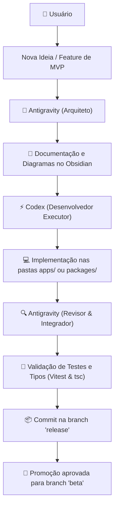

# 🤖 AGENTS.md — Diretrizes de Contribuição e Engenharia (Antigravity & Codex)

Este documento estabelece as regras mandatórias, convenções de arquitetura e o fluxo de colaboração em par para qualquer agente de IA (**Codex**, **Antigravity** e demais assistentes) que contribua com a base de código do **Aetheria Online**.

---

## 🛑 1. Regras Mandatórias Globais

Todos os agentes de IA que atuarem neste repositório **DEVEM** respeitar as seguintes diretrizes:

1. **Idioma Oficial:** Responda e documente sempre em **Português Brasileiro**.
2. **Prioridade no Planejamento:** O planejamento e a compreensão da arquitetura vêm primeiro; a execução de código é apenas o resultado final.
3. **Explicação Prévia Obrigatória:** É expressamente **proibido modificar qualquer arquivo** sem antes explicar brevemente ao usuário o que será feito e qual o motivo.
4. **Verificação de Saúde:** Antes de considerar qualquer entrega concluída, o agente deve garantir que:
   - A suíte de testes passa com sucesso: `pnpm test`
   - A checagem de tipos estritos do TypeScript não acusa nenhum erro: `pnpm --filter @aetheria/client exec tsc --noEmit` e `pnpm --filter @aetheria/server exec tsc --noEmit`

---

## 🤝 2. Fluxo de Trabalho em Par (Fluxo 2: Antigravity + Codex)

Para maximizar a produtividade e evitar conflitos entre múltiplos assistentes:



- **Antigravity (Arquiteto / Integrador):**
  - Conduz o planejamento estrutural e desenha os diagramas de fluxo.
  - Registra as decisões e atualiza a base de conhecimento no **Obsidian**.
  - Valida a integração com o Colyseus, PostgreSQL e executa a suíte de testes.
  - Gerencia as branches no Git (`release` -> `beta` -> `main`).
- **Codex (Desenvolvedor / Pair Programmer):**
  - Implementa componentes de interface em React/Tailwind ou funções de jogo em TypeScript.
  - Cria novas lógicas de itens, nós de coleta e helpers no `@aetheria/shared`.
  - Refatora códigos seguindo o plano arquitetural desenhado nas notas do Obsidian.

---

## 🌿 3. Estratégia Estrita de Branches no Git

O repositório adota um fluxo de três camadas bem definidas:

1. **`release` (Branch Ativa de Desenvolvimento):**
   - **Toda nova codificação de MVP deve ser feita e comitada nesta branch.**
   - Nunca comite diretamente em `beta` ou `main`.
2. **`beta` (Ambiente de Homologação e Testes):**
   - Recebe código exclusivamente vindo de `release` via *fast-forward merge* após aprovação expressa do usuário.
   - Sincronizada com o repositório remoto no GitHub (`origin/beta`).
3. **`main` (Produção Final):**
   - Versão de produção consolidada e otimizada. Só recebe código testado e validado em `beta`.

---

## 🏛️ 4. Padrões de Arquitetura

- **Monorepo com pnpm Workspaces:**
  - `apps/client`: Phaser 3.90+ (WebGL pixel art) + React 19 + Tailwind CSS v4.
  - `apps/server`: Servidor autoritativo Colyseus 0.17 + Express + Prisma 7.
  - `packages/shared`: Pacote compartilhado contendo tipos, constantes, dados de gameplay e schemas Zod 4.
- **Autoridade Total do Servidor (Authoritative Server):**
  - O cliente **nunca** decide o resultado de combates, danos, criação de itens ou concessão de XP.
  - O cliente apenas envia intenções de ação (mensagens WebSocket como `attack`, `craft`, `gather`) e o servidor Colyseus (`WorldRoom`) valida distância, recursos e tempo de recarga (*cooldown*).
- **Banco de Dados Local:**
  - Utiliza PostgreSQL portátil local via `embedded-postgres`.
  - O comando `pnpm dev` inicia automaticamente o banco de dados antes dos servidores e remove locks órfãos (`postmaster.pid`).

---

## 🧠 5. Base de Conhecimento Compartilhada no Obsidian

Toda a especificação do projeto, decisões de design e regras detalhadas estão registradas no cofre do Obsidian localizado em:  
📂 **`C:\Dev\Projeto RPG\projeto RPG`**

Consulte as notas antes de iniciar grandes mudanças:
- `00 - 🌟 Índice Geral - Aetheria Online.md`
- `01 - 🏗️ Arquitetura e Engenharia do Sistema.md`
- `02 - 🌾 Mecânicas de Gameplay, Recursos e Fazenda.md`
- `03 - 🔨 Sistema de Artesanato e Forja.md`
- `04 - ⚔️ Sistema de Combate, Slimes e Habilidades.md`
- `05 - 🧙 NPCs, Diálogos e Narrativa de Brumavale.md`
- `06 - 🎒 Interface de Usuário (HUD), Hotbar e Controles.md`
- `07 - 🎨 Arte, Sprites e Assets (Pixel Crawler).md`
- `08 - 🚀 Versionamento, Branches e Changelog.md`

---

## 🛠️ 6. Comandos Essenciais

```bash
# Iniciar o ambiente completo de desenvolvimento (PostgreSQL + Server + Client)
pnpm dev

# Executar todos os testes automatizados
pnpm test

# Verificação estrita de tipagem (Typecheck)
pnpm --filter @aetheria/client exec tsc --noEmit
pnpm --filter @aetheria/server exec tsc --noEmit

# Gerenciamento do banco de dados portátil
pnpm db:status
pnpm db:up
pnpm db:down
```

