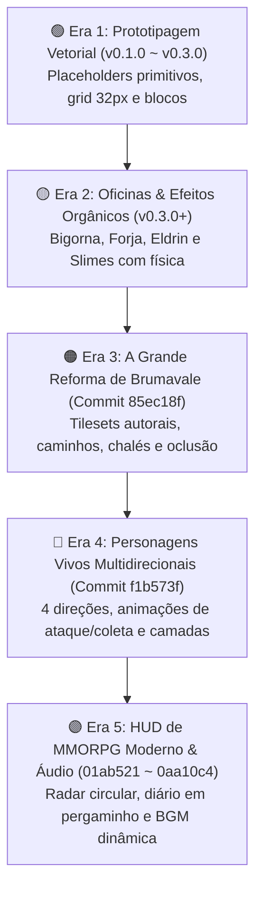
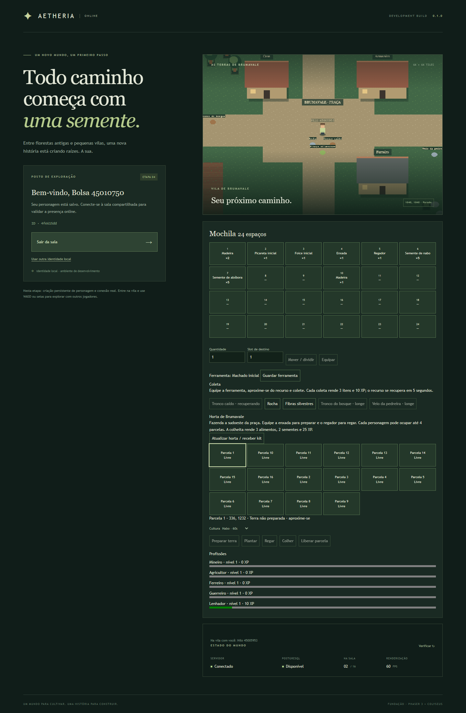
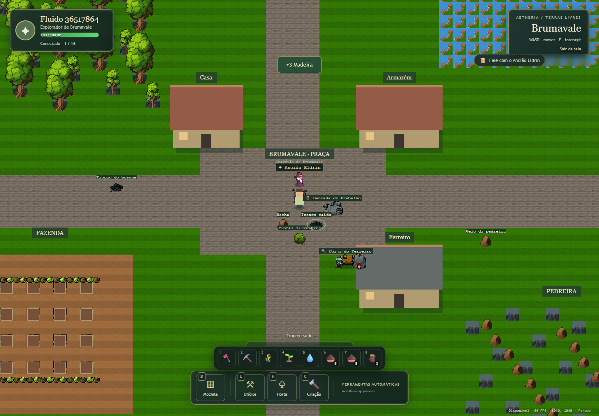
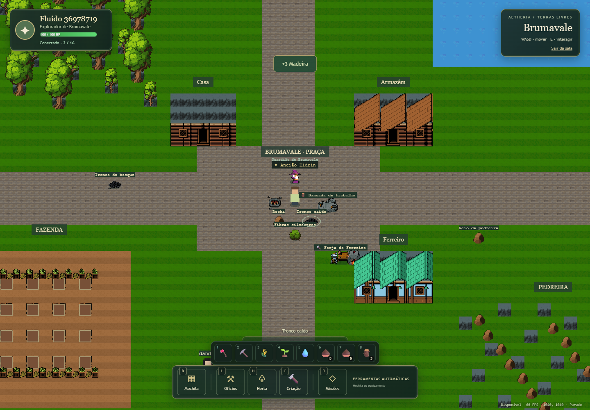
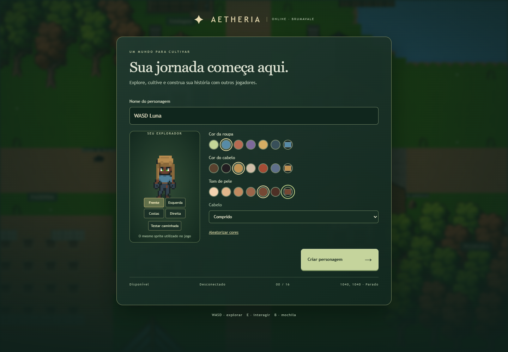
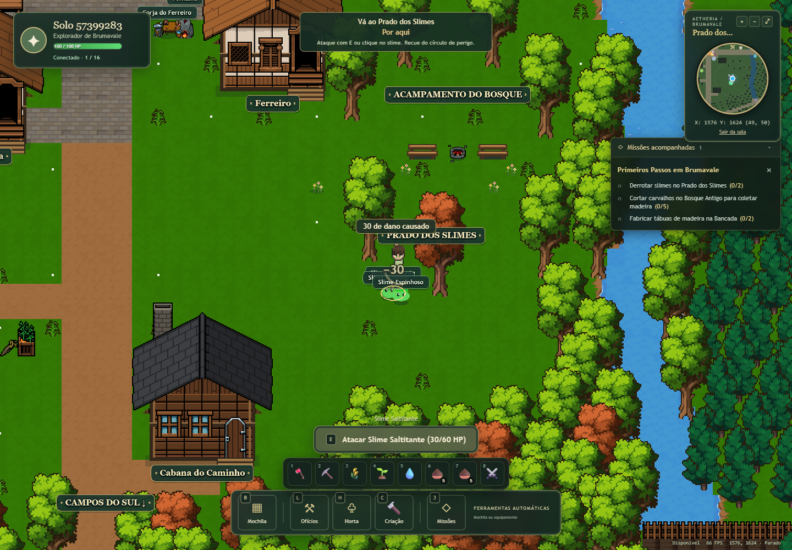
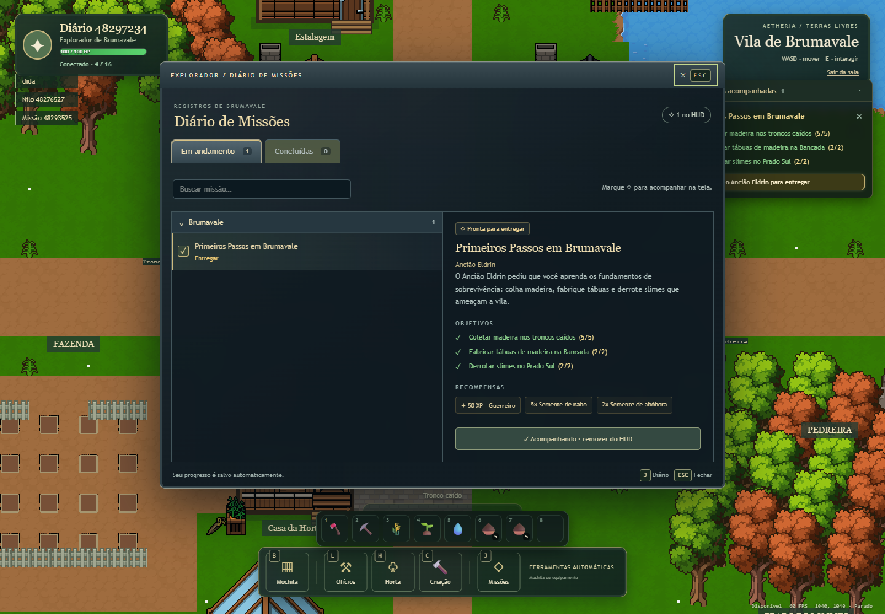

# 🖼️ Linha do Tempo e Evolução Visual — Aetheria Online

Este documento registra o **DevLog Histórico da Evolução Estética e Cenográfica** de Aetheria Online, mapeando cronologicamente as transformações visuais ocorridas desde a primeira fundação técnica em 2D até a versão atual com cenografia imersiva em Brumavale, minimapa circular dourado, combate expressivo e áudio adaptativo.

---

## 🗺️ Visão Panorâmica das Eras Visuais

---

## 📊 Matriz Comparativa de Marcos no Git

| Era | Commit Base | Marco de Versão | Principais Mudanças Visuais | Tecnologias Gráficas |
| :--- | :--- | :--- | :--- | :--- |
| **1. Prototipagem Vetorial** | `ae28b19` ~ `d7997fe` | `v0.1.0` a `v0.3.0` | Círculos e retângulos vetoriais, grid agrícola 4x4 com cores chapadas de safra. | Phaser Primitives (`add.rectangle`, `add.ellipse`) |
| **2. Primeiras Oficinas e Efeitos** | `722157e` ~ `a5718bb` | `v0.3.0+` | Bancada de madeira, forja de pedra, fogueira na praça, slimes com deformação *squish*. | Spritesheets 16-bit, interpolação senoidal |
| **3. A Reforma de Brumavale** | `85ec18f` ~ `afe7162` | `v0.3.0+` | Terreno orgânico, grama texturizada, casas rústicas com telhados de madeira, transparência de cobertura. | Tilemaps 32x32, `fadingCover`, profundidade Y (`depth`) |
| **4. Personagens Multidirecionais** | `f1b573f` | `v0.3.0+` | Spritesheets em 4 direções, gestos de ataque com espada, machadada e picareta, camadas de cabelo/pele. | Atlas de sprites multi-frame, pivot de pés preservado |
| **5. HUD de MMORPG & Áudio** | `01ab521` ~ `0aa10c4` | Atual (`release`) | Radar de navegação circular dourado com bússola, diário de missões, sliders em ouro preenchido e BGM adaptativa. | React 19 + Canvas Math, CSS WebKit custom, Web Audio API |

---

## 📜 Galeria Cronológica e Análise das 5 Eras

### 🟢 Era 1: Prototipagem Vetorial e Fundação Técnica (`ae28b19` a `d7997fe`)

*Figura 1: O início do projeto — interface em formulário de texto e renderização minimalista com primitivas geométricas e grid básico.*

- **Status Inicial:** O foco do projeto residia na estabilidade de rede autoritativa do Colyseus e sincronização a 20 ticks por segundo.
- **Elementos Visuais:**
  - O jogador era representado por uma elipse colorida com sombra vetorial preta semi-transparente.
  - As árvores e pedras de coleta eram círculos verdes e cinzas simples na tela.
  - A fazenda de 16 parcelas utilizava preenchimentos vetoriais estáticos para cada estado de safra (`0x493323` para preparado, `0x659c54` para broto, `0xe8b64e` para pronto).
- **Importância:** Validou o sistema de coordenadas `(X, Y)`, colisão física e latência zero de resposta no navegador.

---

### 🟡 Era 2: Oficinas de Artesanato, Eldrin e Efeitos Físicos (`722157e` a `a5718bb`)

*Figura 2: Transição para tela cheia — chegada do Ancião Eldrin na praça, primeiros sprites de forja, bancada de trabalho e hotbar rápida.*

- **Primeiros Sprites em Pixel Art:**
  - Inclusão dos objetos artesanais de Brumavale: a bancada de carpinteiro, a bigorna de forja e o fogo crepitante na praça.
- **Slimes com Física e Expressividade:**
  - Os monstros ganharam dinâmica visual com física de deformação elástica (*squish & stretch*):
    $$\text{escala}_y = 1 + \sin\left(\frac{t}{150} + x\right) \times 0.12$$
  - Olhos móveis com pupilas que acompanham a direção do jogador e pulsação em tons de alerta (laranja ao carregar golpe e amarelo-claro ao ser atingido).
- **NPC Ancião Eldrin:**
  - Primeiro NPC com presença física no mapa, túnica de eremita e indicador flutuante sobre a cabeça para sinalizar interação.

---

### 🟠 Era 3: A Grande Revolução Artística de Brumavale (`85ec18f` a `afe7162`)

*Figura 3: A reforma cenográfica de Brumavale — chalés com telhados rústicos trabalhados, forja com brasas e armazém de madeira.*

- **Criação da Identidade Autoral de Brumavale:**
  - Substituição do plano de fundo chapado por um cenário bucólico e imersivo inspirado em vilarejos campestres medievais.
- **Camadas Cenográficas:**
  - **Chão e Caminhos:** Caminhos de terra batida sinuosos que conectam as fazendas, bosques, forjas e praça central.
  - **Construções:** Chalés rústicos de madeira e alvenaria com chaminés de pedra e telhados inclinados.
  - **Natureza:** Carvalhos volumosos com folhagens em múltiplos tons de verde musgo e florestas periféricas densas.
- **Sistema de Oclusão Dinâmica (`fadingCover`):**
  - Quando o jogador caminha por trás de copas de árvores ou telhados de chalés, o Phaser aplica atenuação suave de transparência ($\alpha = 0.35$), garantindo visibilidade total do personagem sem perder a sensação de volume da arquitetura.

---

### 🔵 Era 4: Personagens Vivos Multidirecionais e Camadas (`f1b573f`)

*Figura 4: Criador de personagens modular e spritesheets animados em 4 direções com suporte a cabelo, tom de pele e equipamentos.*

- **Spritesheets Multidirecionais:**
  - Substituição da representação vetorial por personagens em pixel art com animações dedicadas para as 4 direções cardeais:
    - **Idle:** Respiração sutil com balanço de postura.
    - **Walk:** Ciclo de marcha fluido em 4 frames.
    - **Attack / Hurt:** Recuo com flash avermelhado e animações rápidas de combate.
- **Gestos de Coleta e Trabalho:**
  - Gestos específicos disparados pelo servidor ao cortar lenha (machado em arco), minerar pedra (impacto com picareta) e regar sementes.
- **Renderização em Camadas (Layered Rendering):**
  - Arquitetura de composição onde corpo, tom de pele, cortes de cabelo e equipamentos se fundem preservando rigorosamente o pivô dos pés no chão.

---

### 🟣 Era 5: HUD de MMORPG Moderno e Áudio Orquestrado (`01ab521` a `0aa10c4`)

*Figura 5: Estado atual consolidado — rio com margens sinuosas, floresta densa, chalé iluminado, radar de navegação circular com bússola, combate com slimes e quest tracker.*

*Figura 6: Diário de Missões em pergaminho medieval com histórico de conquistas, abas de navegação e integração narrativa com o Ancião Eldrin.*

- **Radar de Navegação Circular (Minimapa):**
  - Moldura redonda com borda dourada ornamental na extremidade superior direita do HUD.
  - Indicador de pontos cardeais (`N, S, L, O`), marcadores dos pontos vitais de Brumavale (Fogueira, Forja, Bosque, Pedreira, Campos) e leitura precisa de coordenadas `(X, Y)`.
- **Rastreador de Missões (Quest Tracker & Journal):**
  - Janela modal estilizada em pergaminho medieval com botões de abas, histórico de tarefas cumpridas e acompanhamento ao vivo no canto da tela.
- **Motor de Áudio Procedural 16-bit:**
  - Síntese acústica orgânica para passos no gramado, martelada na bigorna, machadada e fanfarras de subida de nível.
  - **BGM Adaptativa:** Trilha calma de Brumavale (harpa e flauta a 72 BPM) que transiciona de forma dinâmica para modo de ação tenso (baixo staccato a 130 BPM) sob combate, retornando após exatamente 5 segundos fora de perigo.
- **Refinamento dos Controles e Sliders:**
  - Sliders de áudio preenchidos em gradiente dourado integral em 100%, feedback visual explícito de mudo no dock inferior e atalho de teclado universal `M`.

---

## 🎯 Princípios da Direção de Arte de Aetheria

1. **Pixel Art Autêntico (Sem Glitch de Escala):**
   - Renderização limpa em escala inteira (*pixel-perfect*), sem artefatos de interpolação borrada ou linhas trêmulas.
2. **Paleta Terra e Folhagem de Brumavale:**
   - Predominância de verdes florestais (`#243d2f`, `#385743`), dourados de fogueira e trigo (`#eed69b`, `#d4b56a`) e madeiras aquecidas.
3. **Leveza e Desempenho:**
   - 100% dos assets e áudios são carregados instantaneamente no navegador sem downloads pesados, rodando a 60 FPS estáveis mesmo em dispositivos modestos.

